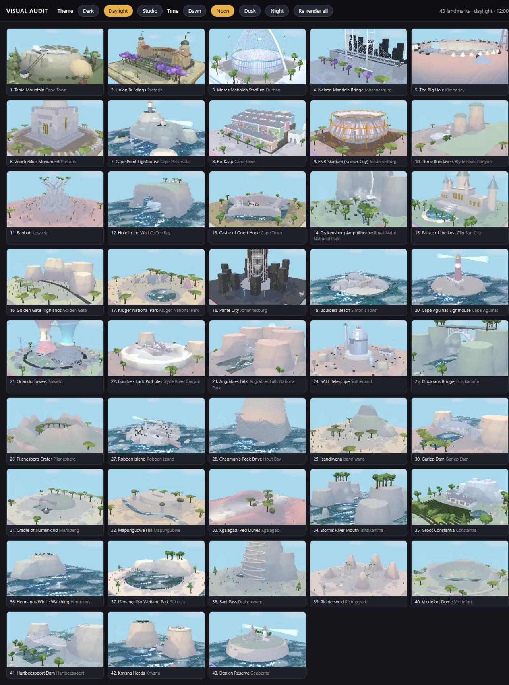
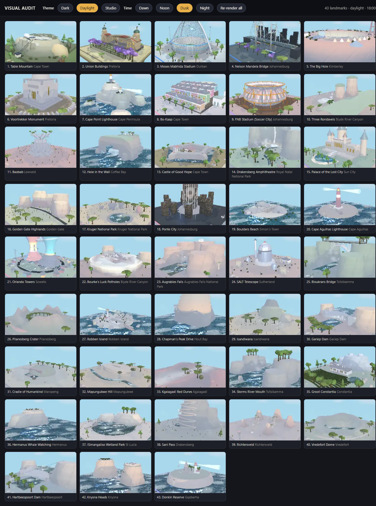
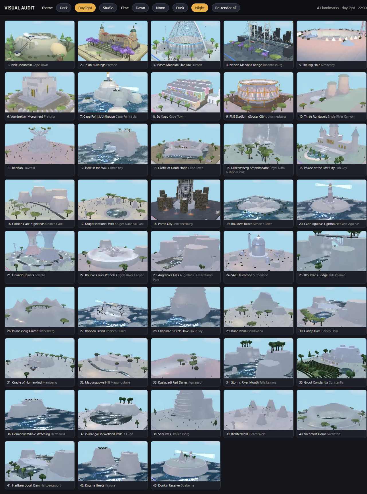
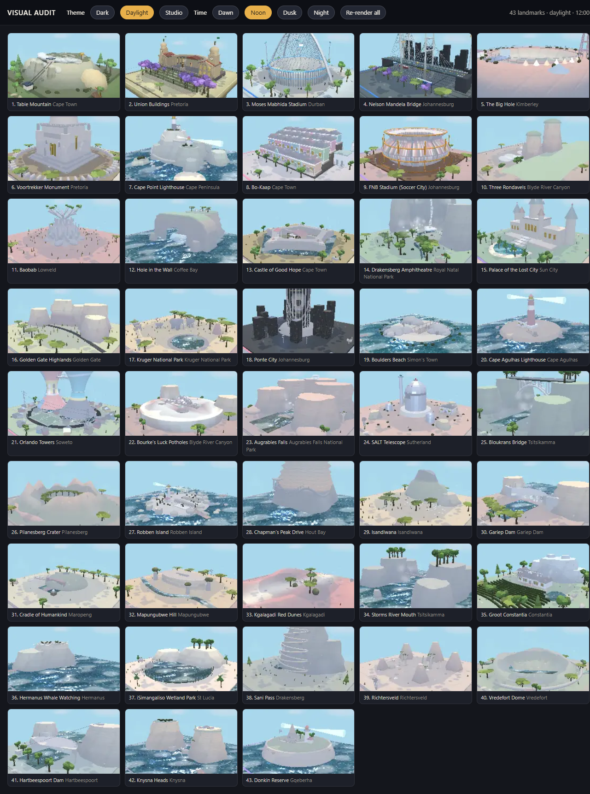
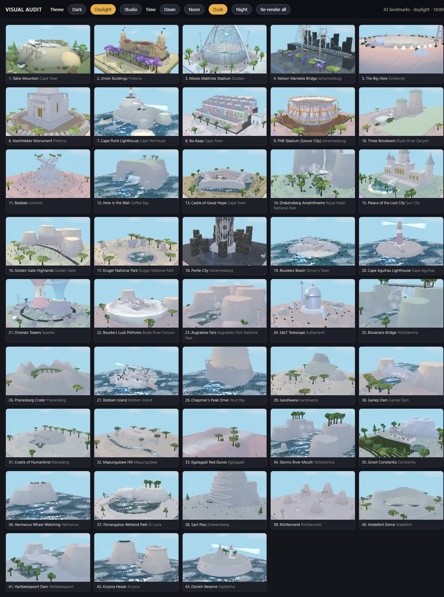
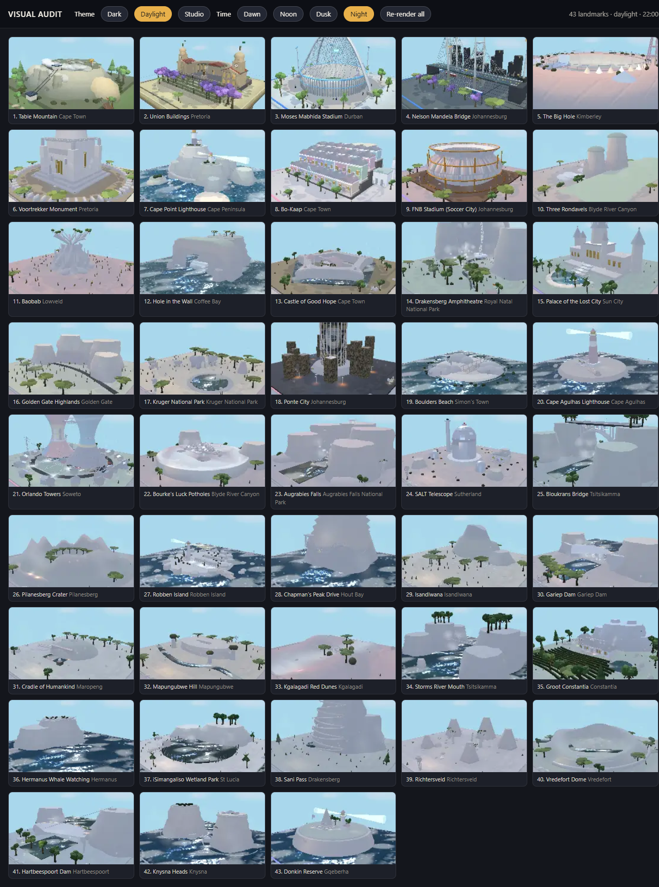
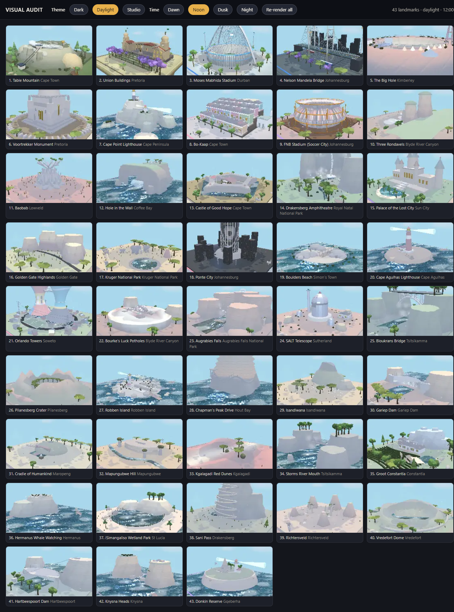

# Living Diorama — audit, baseline & Phase 1 shared systems

Status: **Phase 0 complete; Phase 1 shared systems complete; Phase 2 site roll-out complete and verified at noon, golden and night.**

This document is the pre-change baseline requested for the Living Diorama upgrade. It records:

1. what already exists in the repo versus the brief (deltas only),
2. the baseline contact-sheet screenshots at noon / golden / night,
3. per-site renderer statistics at those three times,
4. the guardrails that later phases must respect.

## Interpretation note

The brief names `docs/LANDMARK_ART_DIRECTION.md` as the render/colour contract, but in this repo that file is a silhouette/reference-feature document. The actual render and colour contract is in `docs/LANDMARK-RESEARCH.md` §1–2 and the per-site corrections/palettes in §3. Phase 0 treats `LANDMARK-RESEARCH.md` as authoritative for colour, tone mapping, and research-corrected details, and `LANDMARK_ART_DIRECTION.md` as form/reference material.

---

## Baseline capture

Captured on 2026-11-22 from the existing contact-sheet path; no instrumentation or source changes were needed.

- Entry: `contact-sheet.html` / `src/contact-sheet.ts`
- Dev server: `pnpm dev`, bound to port **3004** because 3000–3003 were already in use
- URLs:
  - noon: `http://localhost:3004/contact-sheet.html?hour=12`
  - golden/dusk: `http://localhost:3004/contact-sheet.html?hour=18`
  - night: `http://localhost:3004/contact-sheet.html?hour=22`
- Render state: `theme=daylight`, `qualitySetting=high`, `qualityIndex=0`, `isSoftwareGl=false`, composer enabled
- All 43 thumbnails rendered at each time; status line reached `43 landmarks · daylight · HH:00`
- Browser console: no warnings or errors during capture
- Measurement: `renderer.info.autoReset=false`, `info.reset()`, two warmup frames, then 8 `requestAnimationFrame` intervals per site. FPS is `1000 / mean(frame ms)`.

**Caveats:**

- These FPS numbers come from a headless/remote browser on this host. They are a *relative baseline* for later regressions, not evidence that the 60fps laptop / 30fps mobile targets are currently met.
- The screenshots are the existing 210×140 thumbnail contact sheet (fixed thumb camera), useful as a geometry/material/lighting regression sheet. They are not full-frame, full-postFX captures.
- The numeric stats were sampled from the live engine after thumbnail generation restored visibility (`CitylitEngine.ts:2860-2875`), with composer active. They cover the hero diorama only, not Globe or Places modes.
- There is no built-in `renderer.info` UI; sampling used the public `window.citylitEngine.renderer` handle (`CitylitEngine.ts:332-338`).

### Screenshots

| Time | Hour param | Contact sheet |
|---|---:|---|
| Noon | `12` |  |
| Golden / dusk | `18` |  |
| Night | `22` |  |

Full per-site data for all three times is in [`docs/baseline/baseline-stats.json`](baseline/baseline-stats.json).

### Summary statistics

| Time | Calls min / avg / max | Triangles min / avg / max | FPS min / avg / max |
|---|---:|---:|---:|
| Noon | 1,198 / 2,598.5 / 7,559 | 456,394 / 1,361,231 / 10,031,750 | 6.9 / 12.4 / 20.9 |
| Golden | 1,321 / 2,695.9 / 7,631 | 459,814 / 1,366,741 / 10,028,834 | 6.4 / 10.5 / 17.1 |
| Night | 1,177 / 2,551.5 / 7,084 | 449,518 / 1,342,739 / 9,333,658 | 5.3 / 10.5 / 16.4 |

Lowest-FPS sites at noon: Robben Island (6.9), Augrabies Falls (8.5), Bloukrans Bridge (8.9), Drakensberg Amphitheatre (9.1), Bourke’s Luck Potholes (9.4).

Lowest-FPS sites at golden: Bo-Kaap (6.4), Groot Constantia (6.8), Orlando Towers (7.3), Union Buildings (7.7), Robben Island (8.0).

Lowest-FPS sites at night: Knysna Heads (5.3), Donkin Reserve (5.4), Groot Constantia (7.1), Bo-Kaap (7.7), Hartbeespoort Dam (8.1).

### Per-site noon baseline

| # | Site | Calls | Triangles | FPS |
|---:|---|---:|---:|---:|
| 1 | Table Mountain Cape Town | 2,738 | 1,078,054 | 11.6 |
| 2 | Union Buildings Pretoria | 5,846 | 4,166,266 | 11.3 |
| 3 | Moses Mabhida Stadium Durban | 1,822 | 1,515,490 | 10.3 |
| 4 | Nelson Mandela Bridge Johannesburg | 4,061 | 1,674,622 | 11.9 |
| 5 | The Big Hole Kimberley | 1,840 | 1,125,594 | 12.0 |
| 6 | Voortrekker Monument Pretoria | 2,567 | 3,154,026 | 14.1 |
| 7 | Cape Point Lighthouse Cape Peninsula | 3,478 | 1,703,962 | 11.9 |
| 8 | Bo-Kaap Cape Town | 7,559 | 10,031,750 | 10.8 |
| 9 | FNB Stadium (Soccer City) Johannesburg | 2,053 | 1,044,954 | 12.2 |
| 10 | Three Rondavels Blyde River Canyon | 1,764 | 610,318 | 13.3 |
| 11 | Baobab Lowveld | 1,707 | 604,706 | 13.0 |
| 12 | Hole in the Wall Coffee Bay | 2,233 | 641,838 | 13.5 |
| 13 | Castle of Good Hope Cape Town | 3,337 | 952,742 | 12.7 |
| 14 | Drakensberg Amphitheatre Royal Natal National Park | 2,011 | 722,134 | 9.1 |
| 15 | Palace of the Lost City Sun City | 2,055 | 654,646 | 13.7 |
| 16 | Golden Gate Highlands Golden Gate | 1,666 | 530,194 | 19.6 |
| 17 | Kruger National Park Kruger National Park | 1,355 | 590,226 | 16.1 |
| 18 | Ponte City Johannesburg | 3,268 | 1,339,606 | 15.5 |
| 19 | Boulders Beach Simon’s Town | 2,601 | 2,220,206 | 12.2 |
| 20 | Cape Agulhas Lighthouse Cape Agulhas | 2,440 | 952,278 | 10.1 |
| 21 | Orlando Towers Soweto | 4,296 | 1,229,118 | 9.5 |
| 22 | Bourke’s Luck Potholes Blyde River Canyon | 1,901 | 812,862 | 9.4 |
| 23 | Augrabies Falls Augrabies Falls National Park | 2,662 | 754,854 | 8.5 |
| 24 | SALT Telescope Sutherland | 1,733 | 999,946 | 10.1 |
| 25 | Bloukrans Bridge Tsitsikamma | 2,935 | 660,698 | 8.9 |
| 26 | Pilanesberg Crater Pilanesberg | 1,416 | 476,886 | 10.3 |
| 27 | Robben Island Robben Island | 4,389 | 1,693,108 | 6.9 |
| 28 | Chapman’s Peak Drive Hout Bay | 2,613 | 622,598 | 9.9 |
| 29 | Isandlwana Isandlwana | 1,244 | 509,158 | 13.5 |
| 30 | Gariep Dam Gariep Dam | 2,415 | 802,026 | 13.7 |
| 31 | Cradle of Humankind Maropeng | 1,799 | 701,734 | 12.8 |
| 32 | Mapungubwe Hill Mapungubwe | 1,505 | 560,930 | 16.8 |
| 33 | Kgalagadi Red Dunes Kgalagadi | 1,198 | 669,882 | 20.9 |
| 34 | Storms River Mouth Tsitsikamma | 2,208 | 874,242 | 13.8 |
| 35 | Groot Constantia Constantia | 4,654 | 5,798,658 | 10.7 |
| 36 | Hermanus Whale Watching Hermanus | 2,175 | 908,362 | 11.6 |
| 37 | iSimangaliso Wetland Park St Lucia | 2,366 | 582,428 | 11.7 |
| 38 | Sani Pass Drakensberg | 2,314 | 765,890 | 13.9 |
| 39 | Richtersveld Richtersveld | 1,458 | 552,122 | 15.8 |
| 40 | Vredefort Dome Vredefort | 1,280 | 456,394 | 13.6 |
| 41 | Hartbeespoort Dam Hartbeespoort | 2,341 | 676,281 | 10.8 |
| 42 | Knysna Heads Knysna | 3,866 | 1,173,612 | 10.4 |
| 43 | Donkin Reserve Gqeberha | 2,565 | 937,526 | 13.2 |

The +10% budget guardrail will be tightest on the existing heavy sites. Matching-time noon ceilings include:

- Bo-Kaap: ≤8,315 calls, ≤11,034,925 tris
- Union Buildings: ≤6,431 calls, ≤4,582,893 tris
- Groot Constantia: ≤5,119 calls, ≤6,378,524 tris
- Robben Island: ≤4,828 calls, ≤1,862,419 tris
- Orlando Towers: ≤4,726 calls, ≤1,352,030 tris

---

## Delta audit A–F

Legend: **EXISTS** = already satisfies this part; **PARTIAL** = useful foundation but brief gap remains; **MISSING** = no implementation; **WRONG** = present but contradicts the brief/research.

### A — Natural biome-true colour

| Item | Status | Delta / evidence |
|---|---|---|
| Shared biome palette | PARTIAL | `src/types/citylit.ts:84-91`, `src/three/siteVisuals.ts:50-219`, `src/three/nightPalette.ts:24-42`, `src/three/lightingRig.ts:101-112`. Only 7 broad keys (coastal, waterfall, mountain, savannah, urban, desert, wetland). Add fine-grained regional palettes (fynbos, highveld, Karoo, KZN, forest, Limpopo) as a resolver layered over the existing tables. |
| Per-site overrides | EXISTS | `src/three/siteVisuals.ts:221-1259`, `src/three/siteAtmosphere.ts:104-123,399-413`, `src/three/windParticles.ts:239-245`. Reuse `normalizeSiteVisualKey` for apostrophe variants; no new override mechanism needed. |
| Vegetation by biome | PARTIAL / MISSING | Fine species exist only as one-offs: `quiverTree` `src/three/builders/primitives.ts:2384`, `halfmensTree` `:2465`, `baobab` `landmarksA.ts:2110`, jacaranda colour `windParticles.ts:239-245`, fynbos slopes `landmarksA.ts:190-204`. No shared named species vocabulary or biome contract. |
| Stone by geology | PARTIAL | `MStone` caches by colour/roughness/bump `primitives.ts:486-503`; `rock()`/tint/weathering `:999-1186`; geology metadata in `src/data/landmarkDetails.ts` is not consumed by visual code. Add a geology→palette lookup or explicit per-site authoring. |
| Water truth | EXISTS, GOTCHA | Explicit inland colours are already passed at surveyed call sites (`landmarksA.ts:2580`, `landmarksB.ts:96,2790`), but defaults remain marine (`MWater('#1a7598')` `:584-603`, `sea(...,'#2da8b8')` `:2789-2812`). Guard against new bare calls reintroducing turquoise inland water. |
| White / `L*25` floor | MISSING | No `albedo` or `L*25` concept in `src`. `boostBuiltVibrancy` only skips achromatic/natural surfaces (`primitives.ts:451-470`), and `postfx.ts:84-86` lifts a narrow dim band. Add an explicit perceptual floor in the grade/tone-map path, not by mutating shared materials. |
| Season in foliage | PARTIAL | Southern-hemisphere season weights exist (`src/lib/season.ts:8-24`), `clSeasonMorph` in `src/three/shaders/season.glsl.ts:14-31`, and uniforms in `src/three/shaders.ts`. Missing summer-rain vs evergreen distinction and true October jacaranda gating. |
| Material caches / vibrancy | EXISTS | `matCache`, `foliageCache`, `grassMatShared` at `primitives.ts:113-122`; one-time `vibrancyApplied` `:451-470`, applied at `dioramaKit.ts:3380`. Extend cache keys or use uniforms; do not mutate shared colours per frame. |

### B — Sun, sky, illumination and shadows

| Item | Status | Delta / evidence |
|---|---|---|
| Southern-hemisphere sun path | WRONG | `src/three/weatherScene.ts:612-636,699-700,821-823` moves the sun only in X/Y with fixed `sz = 18`; north is `-Z` (`src/types/citylit.ts:203`), so the sun currently transits **south**. Add an azimuth sweep so it transits north, and vary altitude by latitude/declination. |
| Season/latitude altitude | MISSING | `weatherScene.ts:616-621`, `src/three/streetLights.ts:33-38`. Noon is effectively constant (`sy = 34`). `sunAltitudeDeg()` is a lamp-schedule cue (90° at noon), not physical altitude; do not treat it as astronomy. |
| Light temperature schedule | EXISTS | `weatherScene.ts:459-480,702-707,814-823`, `lightingRig.ts:63-95`, `nightPalette.ts:24-35`. Reuse summer/winter, autumn, cool night key and warm horizon rim. |
| Moon key | PARTIAL / MISMATCH | Cool night key exists (`weatherScene.ts:492-493,631-636`) and a moving `moonLight` exists (`CitylitEngine.ts:4041-4048`), but the key “moon” position is fixed. Reconcile if the brief requires a physically moving moon key. |
| `nightLift` / `L*25` floor | PARTIAL | `siteVisuals.ts:37,68-1247`, `CitylitEngine.ts:4050-4056`, `postfx.ts:76-88,238-258`. `nightLift` only feeds a subtle grade lift; no perceptual floor. |
| Shadow config / throttling | EXISTS | `lightingRig.ts:7-60`, `CitylitEngine.ts:355-361,1669-1675,1883-1894,3994-4001,4231-4247`. Keep `PCFShadowMap` + `shadow.radius` (`PCFSoftShadowMap` is removed in r187), `shadowMap.autoUpdate=false`, bounded ortho, and threshold/stride-throttled `needsUpdate`. Add refit on sun movement if the new path moves enough. |
| Sky astronomy | MIXED | Fog (`CitylitEngine.ts:372`, `weatherScene.ts:742-764`), biome atmosphere (`siteAtmosphere.ts:79-123`), Milky Way band (`weatherScene.ts:102-110`) and 400 random stars (`:230-258`) exist. Southern Cross, Magellanic Clouds, and shooting-star events are missing. |
| Beacons / windows / photocells | EXISTS | Lighthouse sweep `dioramaKit.ts:3087-3167`, window schedule `windowLights.ts:119-149,270-298`, 4-light lamp pool + photocells/offsets `streetLights.ts:45-99`, `CitylitEngine.ts:1129-1174,1498-1506`. Reuse; do not add real lights per bulb. |
| GI / ambient | EXISTS but static | 7×7×5 probe volume `globalIllumination.ts:14-17,83-165`, rebuilt only on `attachEquirect` (`CitylitEngine.ts:336,390-392,406,4096-4107`). Day/night relies on environment intensity and weather lights; add time-varying probes only if required. |

### C — Horizon / far field

| Item | Status | Delta / evidence |
|---|---|---|
| Multi-band horizon | EXISTS | `src/three/horizonScenery.ts:51-203,214-217`: three world-fixed cylinder rings at radii 28/41/57 with mountain/dune/coast/skyline profiles, night/day response, haze, twinkle and studio fade. |
| Biome mapping | PARTIAL | `horizonScenery.ts:33-49` folds `waterfall→mountain`, `savannah→dune`, `wetland→coastal`. Fine-grained regional signatures are absent. |
| Per-site far silhouettes | MISSING | No extruded far landmark geometry; site identity is colour-only via `setSiteTint` (`horizonScenery.ts:317-319,364`). Add low-contrast silhouette signatures if the brief requires recognizable distant forms. |
| Mid-distance props in horizon | MISSING | Only shader bands plus ground catcher/aura (`:220-297`). No small-scale horizon props. |
| Wiring / lifecycle | EXISTS | Engine update `CitylitEngine.ts:4142-4151`; disposal `:4295`; `noDissolve` on horizon materials (`horizonScenery.ts:195,271,290`). Preserve world-fixed root and studio-fade behaviour. |

### D — Diorama kit, props and vegetation

| Item | Status | Delta / evidence |
|---|---|---|
| Upgrade orchestration / profiles | EXISTS | `applyDioramaUpgrade` `dioramaKit.ts:3344-3396`, `SITE_PROFILES`/`getSiteProfile`/`normalizeProfileKey` `:65-586`. Unknown profiles silently fall back to mountain/deck; keep profiles in sync. |
| Rim, scatter, anchors, FX, birds, audio | EXISTS | `paintStrata`/rims `:647-911`, scatter `:1232-1305`, anchors `:1329-1555`, weather/motion `:1576-1902`, birds `:3256-3337`, spatial audio `:3173-3254`. Anchor kinds are only `jetty|windpump|bollards|deck|reedbed`. |
| Regional species vocabulary | PARTIAL / MISSING | No named `acacia()`, `camelthorn()`, `marula()`, `yellowwood()`, `milkwood()`, `fynbos()`, `protea()`, `silverTree()`. Existing flat-canopy `tree(k=2)` `primitives.ts:1502,1505-1517` is the acacia starting point; quiver/halfmens exist but are not selectable from `SITE_PROFILES.ring`. |
| Furniture / human hints | PARTIAL / MISSING | Site-only benches/boardwalks/cairns; no shared bench, sign, picnic table, bin, flagpole, kraal fence, washing line, crates, or parked 4x4 helper. Add a small reusable prop kit rather than bespoke per-site meshes. |
| Batching / contacts | EXISTS | `finalizeTreeBatch()` LOD instancing `primitives.ts:1639-1728`, `mergeByMaterial` `:694-738`, `instancedMeshes` `:772-798`, `railing` `:801-836`, `cableBatch` `:940-972`, two-phase contact shadows `:2846-2984` and `dioramaKit.ts:3362-3363`. New animated props need `hasAnimatedShadowMeshes` handling (`:3384-3385`). |
| Lamp contexts | EXISTS | `StreetLampKind` and `LAMP_ARCHETYPES` cover victorian, cobra, bollard, flood, lantern, uplight (`dioramaKit.ts:2184-2275`, emitter `:2845-3079`). Reuse `addStreetLampSet`; `lampPost()` `primitives.ts:1908` has no callers and should not be reintroduced. |

### E — Traffic with night headlights

| Item | Status | Delta / evidence |
|---|---|---|
| Vehicles + visual night lights | EXISTS | `car()` `primitives.ts:2205-2302` with headlight/taillight additive shaders gated by `WU.lit` (`:2118-2203`) and rain-only ground pool (`:2077-2116`). Local forward is `+X` (`:2238-2241,2268-2272`). |
| Batched headlight system | MISSING | Car lights are per-car meshes; street lamps use real `InstancedMesh` batches (`dioramaKit.ts:2845-3079`). Reuse that pattern: cached lens/beam/pool/halo geos, WU-gated additive materials, spec→transform derivation, fixed light-count anchors, no new PointLights. |
| Brake flares / robots | MISSING | No `brake`, `traffic light`, `robot`, or signal implementation in `src/three`. |
| Left-hand traffic / lane offsets | WRONG / MISSING | Opposing lanes are hard-coded in several sites (`landmarksA.ts:649-659,1022-1048`, `landmarksB.ts:464-493`) with no named left-hand rule; spline traffic follows centreline (`landmarksA.ts:1753-1758,2875-2880`, `landmarksB.ts:949-956`) so cars can overlap. Add explicit lane offsets and direction. |
| Reusable traffic helper | MISSING | Spline/loop/linear motion is duplicated per site. Add one shared route+vehicle-light builder. |
| Places taxis | PARTIAL / IMPROVED | Places vehicles now use a dedicated warm-white lamp material with a night-only emissive curve (`placesSliceBuilders.ts` `headlightMat` + `tick`), instead of the shared amber window material. Still a flat lens, not the WU-gated additive beam/pool used by landmark `car()`. |

### F — Water and rivers

| Item | Status | Delta / evidence |
|---|---|---|
| Diorama water stack | EXISTS | `MWater()`/`waterize()` `primitives.ts:584-603`, `shaders.ts:587-690`; `MCascade()`/`:605-623`; wet roads `:625-649`; `sea()` `:2789-2812`; diorama plate `dioramaKit.ts:1135-1165`; edge waterfall ribbon `:1079-1133`. |
| Places cutaway water | EXISTS | `src/three/shaders/water.glsl.ts:3-280`, `placesShaders.ts:179-274`, depth/shore attributes in `placesSliceBuilders.ts:474-560`. Not interchangeable with diorama `waterize()`. |
| Flow direction / speed | MISSING / PARTIAL | `cascadeize()` has fixed `uWT*9` scroll (`shaders.ts:732`); no per-river flow vector or speed uniform. |
| Confluence / two-tone mixing | EXISTS (PLACES) | `WaterConfluenceSpec` seam + second palette in `placesShaders.ts` and `WATER_TOP_FRAGMENT`/`WATER_WALL_FRAGMENT`; Gariep Dam mixes muddy inflow into the reservoir along its `z = 0.14` pinch. Diorama `waterize()` still has no mixing mask. |
| Tides | EXISTS (PLACES) | `WaterTideSpec` drives a sinusoidal surface + cut-wall displacement from `WU.t`; coastal `oceanWater` slices breathe on a 12-second cycle. Reduced motion freezes it automatically. |
| Pointer wake | EXISTS (PLACES) | `WU.wake`/`WU.wakeStrength` are fed by `PlacesController.updatePointerWake()` (waterline raycast) and consumed by `WATER_TOP_FRAGMENT` normal + foam ripples; disabled under reduced motion. |
| Night moon path on Places water | MISSING / PARTIAL | Diorama sparkle (`shaders.ts:677-682`) and horizon moon track (`horizonScenery.ts:219-266`) exist; cutaway glints are sun-only/dark (`water.glsl.ts:137-139`). |
| Lamp reflections on water | PARTIAL | Helper exists (`dioramaKit.ts:2663-2752`) but only three isiMangaliso bollards set `reflectY` (`landmarksB.ts:1876-1878`). |
| Water prewarm / waterfall sophistication | PARTIAL | `MWater`/`MCascade` are prewarmed (`CitylitEngine.ts:3499-3568`), cutaway materials are not. Falls are scrolling slabs + drift; `WATERFALL_ANCHORS` (`dioramaKit.ts:3173-3180`) are audio anchors, not flow anchors. |

### G — Animals and fauna scaffolding

| Item | Status | Delta / evidence |
|---|---|---|
| Animal builders + site use | EXISTS | `animal()` `primitives.ts:2360-2381`; `elephant()` `:2498-2574` + Kruger `landmarksA.ts:2891-2894`; `penguin()` `:2577-2621` + Boulders `landmarksA.ts:3160-3179`; `whale()` `:2624-2659` + Hermanus `landmarksB.ts:1755-1759`; `hippo()` `:2662-2689` + iSimangaliso `landmarksB.ts:1881-1890`; `gemsbok()` `:2692+` + Kgalagadi `landmarksB.ts:1309-1310`; birds `primitives.ts:1996-2058` across most coastal/mountain/water sites. |
| Ambient animal motion | EXISTS | Generic bob/orbit/rock/breach: `landmarksA.ts:2926-2932`, `landmarksB.ts:585-592,1316-1325,1899-1907`, shared `addSiteMotion()` `dioramaKit.ts:1742-1935`. |
| Batching / LOD / contacts | EXISTS | `instancedMeshes()` `primitives.ts:772-798`, tree LOD `:1639-1705`, background penguin batch `landmarksA.ts:3173-3179`, soaring-bird LOD `dioramaKit.ts:3276-3280`, two-phase contact stamps `primitives.ts:2846-2984` + `dioramaKit.ts:3361-3363`. |
| Season + audio hooks | PARTIAL | Season weights `season.ts`, shader colour `shaders.ts`, seasonal audio `ambientAudio.ts`. Named `PlantSpecies` vocabulary + `isSpeciesBlooming()` gate in `season.ts`; jacarandas in the Union Buildings slice wrap a green canopy with an Oct/Nov-only violet blossom shell. Spatial kinds are still only waterfall/surf/birds/insects (`types/citylit.ts:95-121`, `dioramaKit.ts:3187-3254`). |
| Per-species idle signatures | MISSING | No graze / look-up / waddle / submerge state in the animal helpers; site ticks only reposition/rotate/rock merged geometry. Add a shared scaffold (spec + tick + contact stamp + optional LOD) rather than bespoke per-site animation. |
| Season gating of animals/motion | MISSING | Shared site motion gates by key/biome and `WU.lit`, not month/season (`dioramaKit.ts:1738-1937`). Global season currently affects colour and audio only. |
| Animal-specific audio | MISSING | No elephant/whale/penguin/hippo/gemsbok sound hook; discrete events cover shorebird/cicada/frog only (`ambientAudio.ts:69-91,309-321`). |
| Dedicated contact stamps | PARTIAL | Animals get generic mesh stamping only when they pass span/height rules; `InstancedMesh` is excluded (`primitives.ts:2866-2872`). Trees/lamps have explicit stamps (`primitives.ts:1689`, `dioramaKit.ts:2938`). |

### H — Interactions, fit-to-stand and QA tooling

| Item | Status | Delta / evidence |
|---|---|---|
| Markers, pins, interaction plumbing | EXISTS | Fact dots from `LANDMARKS[index].dots` `CitylitEngine.ts:1079-1097`, user pins `:841-923,998-1026`, tap dispatch `:3365-3407`, callbacks `:91-92` + `App.tsx:462-464`, hover rim `:3183-3266,3988-4012`, camera easing `:2505-2581`, cutaway `:1028-1041,1405-1450`, dissolve `:3795-3843`. |
| Fit / shadow helpers | EXISTS | `computeDioramaBounds()` `CitylitEngine.ts:2674-2695`, `fitDioramaShadowBounds()` `lightingRig.ts:28-43`, `configureDioramaShadow()` `:3-24`, used for notes/cutaway/framing/reset (`CitylitEngine.ts:952-963,1408,1604-1605,1846-1853,2570-2572,2705-2707`). |
| QA tooling | EXISTS | Dev-only contact sheet `src/contact-sheet.ts:5,26-84` + `contact-sheet.html`; `generateThumbnailsAsync()` `CitylitEngine.ts:2740-2891`; gallery capture `:2972-3008`; `window.citylitEngine` eval handle `:332-338`; ad hoc `probe-shots.mjs` / `probe-flicker.mjs`. |
| Per-site signature taps | MISSING | No registry or builder-side `onTap` metadata. Extension point today is adding `[x,y,z,text]` to `dots` in `src/data/landmarks.ts:24-27`; custom behaviour needs a new keyed registry reusing `focusOnFactPoint()` (`CitylitEngine.ts:2505-2526`). |
| True cutaway cross-section | WRONG | Current mode lifts self-contained upper meshes above 42% relative height (`CitylitEngine.ts:1405-1450,1430-1440`) — an exploded-layer lift, not a modelled interior reveal. |
| Load shedding / Howick easter egg | MISSING | No source or doc hits for those concepts. |
| Passport “Stats” as perf stats | WRONG | Passport stats are visited/remaining discovery counts by province (`components/PassportModal.tsx:37-45,141-153,308-320`), not renderer stats. |
| Dev bounds audit / clamp test | MISSING | `computeDioramaBounds()` is used but not audited. No pure-math fit/plinth clamp helper or unit test; existing generic `clamp()` lives in a motion module (`src/lib/motion.ts:138-139`) and local copies exist in `osmSlice.ts:19`. |
| Plinth rim as config | WRONG | `±8.52` is inline in the rim `THREE.Shape` (`CitylitEngine.ts:556-568`), not shared with bounds/fit logic. |
| Built-in perf instrumentation | MISSING | No `renderer.info`/draw-call/FPS logger in `src`; only an internal auto-quality dt monitor (`CitylitEngine.ts:3642-3663`). Baseline sampling must use the public engine handle via eval. |
| Wired screenshot/perf scripts | MISSING | `package.json:7-16` has no perf/screenshot script; `test` covers only `src/lib/*.test.ts`. Probe scripts are unregistered and hardcode CDP 9222 / port 3003 (`probe-shots.mjs:5,73`, `probe-flicker.mjs:3,98`) rather than dev port 3000. |
| Contact sheet in production build | WRONG | Dev-only; no `rollupOptions.input` entry for `contact-sheet.html` (`vite.config.ts:105-147`), and production `server.js:13-25` falls back to `dist/index.html`. |
| App `theme` / `hour` / `weather` URL params | MISSING | Main app reads theme from localStorage and landmark from hash (`App.tsx:56-63,162-165`, `urlState.ts:8-14,33-56`); contact sheet alone supports `theme`/`hour` and fixes weather to `'sun'` (`contact-sheet.ts:7-14,72,82`). |
| Contact sheet as full-scene baseline | WRONG if used for perf parity | Fixed thumb camera/210×140 RT, hides weather/wind/horizon/atmosphere/globe/places/markers and bypasses full composer (`CitylitEngine.ts:2748-2856`). Use it for geometry/material/lighting regression only. |

---

## Carry-forward invariants

These research-corrected details must not regress in later phases:

- Two Cape Point lighthouses.
- Unequal Mandela Bridge pylons.
- 64-wagon laager.
- Stone (not copper) Union Buildings domes.
- Grey basalt Drakensberg Amphitheatre.
- Silt-olive Augrabies water.
- Black-footed penguins with pink eye patches.
- Southern-hemisphere sun transits north; January is summer, July winter, October spring.
- Keep `three@0.187.0`, `PCFShadowMap`, `shadowMap.autoUpdate=false`, HalfFloat composer target, ACES filmic tone mapping with renderer tone mapping skipped in render targets, and ~1.8× miniature-pass exposure.
- Keep ≤4 promoted street-lamp point lights + ≤2 site night lights; headlights must follow the batched additive lamp pattern.
- Use `normalizeProfileKey` / `normalizeSiteVisualKey` for all site-keyed lookups (curly/straight apostrophes).
- No new runtime dependencies; no imported GLTF/texture assets; no per-frame material/colour/vector allocation; keep shader prewarm and software-GL fallback.

## Phase 0 verification

- `pnpm lint`: pass. One pre-existing warning from `.opencode/plugins/graphify.js:30` (`no-underscore-dangle`); unrelated to this audit.
- `pnpm test`: pass — 19 tests, 0 failures.
- `pnpm build`: pass — 5,611 modules, PWA generated. Pre-existing Vite chunk-size warning only.
- No source files changed in Phase 0; only `docs/SCENERY-UPGRADE.md` and `docs/baseline/*` were added.

## Entry criteria for Phase 1

Do not begin visual edits until this Phase 0 report is reviewed. Phase 1 should then implement shared systems first (biome palette resolver, corrected sun path, horizon signatures, vehicle-light and prop kits, water upgrades, animal scaffolding, fit-to-stand checks) and re-run the same contact-sheet URLs and measurement method after each batched site group.

---

# Phase 1 — shared systems (complete)

Phase 1 was authorised after the Phase 0 review. It is an extension of the existing engine, not a rewrite: no renderer architecture, scene graph, or site builder was replaced. All edits are uncommitted.

## What landed

| Workstream | Phase 1 change | Guardrail preserved |
|---|---|---|
| Regional colour | `src/lib/biomePalette.ts` resolves 8 South African regions; `src/three/siteVisuals.ts` blends them into site profiles. | `grade`, `nightLights`, and `rimBoost` remain authoritative; `normalizeSiteVisualKey` still handles apostrophe variants. |
| Sun path | `src/lib/solarPosition.ts` + `weatherScene.ts` + `setSiteLatitude()` move the physical sun/moon transits north by latitude/date. | `sunAltitudeDeg()` remains only a lamp-schedule cue; `PCFShadowMap` and `shadowMap.autoUpdate=false` unchanged. |
| Far field | `horizonScenery.ts` adds one instanced silhouette signature per region, wired from `CitylitEngine` via `setSiteSignature(lmMeta.k, lmMeta.biome)`. | One extra draw call, ≤288 triangles; world-fixed root, studio fade, haze/night response, and disposal unchanged. |
| Vehicles / traffic | `trafficMath.ts` provides named left-hand lane offsets and `+X`-forward yaw; `vehicleLightKit.ts` batches beams/tails/pools; `car()` gained `withLights`; Mandela Bridge uses the batch. | No new `PointLight`; additive WU-gated materials and fixed light-count batches only; no per-frame allocation. |
| Props | `propKit.ts` adds merged benches, signs, picnic tables, crates, kraal fence, cairns, path markers, and awnings; representative camp/sign props placed at Table Mountain and Kruger. | Shared material/geometry caches; no new light sources. |
| Water | `MWater(..., flow?)` bakes river direction/speed into water shaders; Augrabies slot and river use silt-olive water. | Inland colours stay explicit; shader cache keys are versioned (`water_v8_*`). |
| Animals | `animalKit.ts` wraps existing builders with per-species idle poses, month/season gating, one contact-shadow batch per herd, and distance LOD; Kgalagadi's gemsbok herd now uses it. | `motionScale=0` writes a deterministic rest pose; reduced motion, contact stamps, and instancing preserved. `setSeasonMonth()` publishes the month to scaffolds. |
| Fit-to-stand | `fitMath.ts` shares the plinth constants with the rim `Shape`; every loaded site gets a non-visual `userData.plinthFit` / `fitsPlinth` audit. | No silent rescale of existing heroes. |
| Research corrections | 64-wagon laager, stone Union Buildings domes, grey basalt Amphitheatre, silt-olive Augrabies water, two Cape Point lighthouses, and black-footed pink-eye-patch penguins remain intact. | `docs/LANDMARK-RESEARCH.md` remains the authoritative colour/render contract. |

## Phase 1 capture

The same three dev-only URLs, quality state, and measurement method were used. The single 43-site browser evaluation exceeded the 60 s tool timeout, so each hour was sampled in five chunks with an unchanged per-site procedure; no images or engine settings were changed between chunks.

- Screenshots:
  - 
  - 
  - 
- Full per-site data: [`docs/phase1/phase1-stats.json`](phase1/phase1-stats.json)

### Phase 1 vs Phase 0 summary

| Time | Calls min / avg / max | Triangles min / avg / max | FPS min / avg / max | Worst calls Δ | Worst tris Δ |
|---|---:|---:|---:|---:|---:|
| Noon | 1,020 / 2,313.9 / 6,556 | 409,888 / 1,214,505 / 8,614,512 | 5.8 / 8.9 / 13.8 | −1.66% | +4.66% |
| Golden | 1,076 / 2,359.7 / 6,612 | 412,608 / 1,207,561 / 8,611,600 | 5.7 / 9.3 / 13.3 | −5.74% | −7.09% |
| Night | 972 / 2,254.7 / 6,492 | 409,408 / 1,204,361 / 8,608,400 | 6.4 / 9.6 / 12.4 | −4.65% | −4.73% |

No site exceeds the +10% draw-call or triangle ceiling at any hour. The largest triangle increase is Mapungubwe at noon (+4.66%), well inside its ceiling. The lower absolute FPS is expected from a headless/remote browser and is not a device certification; it is not evidence of a per-site cost regression.

### Tightest noon ceilings

| Site | Calls / ceiling | Tris / ceiling |
|---|---:|---:|
| Bo-Kaap | 6,556 / 8,315 | 8,614,512 / 11,034,925 |
| Union Buildings | 5,184 / 6,431 | 3,638,176 / 4,582,893 |
| Groot Constantia | 4,308 / 5,119 | 5,277,232 / 6,378,524 |
| Robben Island | 3,848 / 4,828 | 1,479,560 / 1,862,419 |
| Orlando Towers | 3,832 / 4,726 | 1,121,104 / 1,352,030 |

## Phase 1 verification

- `pnpm lint`: pass; only the pre-existing `.opencode/plugins/graphify.js:30` warning remains.
- `pnpm test`: 49/49 pass, including new palette, solar, traffic, fit, and animal-helper tests.
- `pnpm build`: pass; Vite emitted 5,618 modules and the PWA, with the pre-existing chunk-size warning.
- `graphify update .`: pass; AST-only rebuild of the changed files.
- No commits, pulls, PRs, or pushes were made.

## Phase 2 carry-forward

- Wire the remaining traffic sites (notably the R712 route cars) to `createVehicleLightBatch()`; keep brake lights and any robots in the same fixed-count additive pattern.
- Expand `propKit` and `animalKit` to more sites without reintroducing per-site bespoke mesh code; add kalahari/forest species vocabulary where research supports it.
- Add explicit albedo/`L*25` floor checks to the grade path; author against ≤0.75 sRGB albedo and 0.80–0.88 white ceiling.
- Add Southern Cross, Magellanic Clouds, and occasional shooting stars only if they stay behind the existing horizon/atmosphere fade.
- Replace the exploded-layer cutaway with a true modelled cross-section.
- Register repeatable perf/screenshot scripts; certify 60 fps on a mid-range laptop at High and ≥30 fps on mid mobile at Medium outside the headless browser.
- Re-run the noon/golden/night contact sheets after each Phase 2 site group and keep the +10% per-site caps.

---

# Phase 2 — site-specific roll-out (implemented)

All five selected Phase 2 batches were implemented as extensions to the Phase 1 kits. No commits were made.

## What changed

| Batch | Change | Guardrail preserved |
|---|---|---|
| Traffic | `attachVehicleLights()` in `vehicleLightKit.ts` now drives all 12 diorama car groups from one batched rig per site; `car()` is always called with `withLights=false`. `trafficMath.ts` lane offsets and `headingYaw()` were applied to the stadium boulevard, Cape Point switchback, Mandela Bridge, R712, Ponte, Orlando, Bloukrans, Chapman’s Peak, Groot Constantia and the two remaining spline routes. | No new `PointLight`; fixed-count additive WU-gated beams/tails/pools; one pose array per rig; no per-frame allocation. |
| Fauna & props | `animalKit.ts` now also drives Boulders’ waddling penguin colony and a winter/spring Hermanus whale pod (in addition to Phase 1’s Kgalagadi gemsbok). `propKit.ts` adds an interpretive sign and bench at Boulders and Hermanus, and a picnic table, awning and sign at Groot Constantia. | Existing species builders only; month/season gating via `setSeasonMonth()`; reduced-motion rest pose; one shared contact-shadow batch per herd; no new lights. |
| Colour / grade | New pure `src/lib/albedoAudit.ts` + 11 tests encode the ≤0.75 sRGB albedo, 0.80–0.88 white, 0.15–0.35 hero luminance and 5–12% desaturation contract. `postfx.ts` bakes a tiny grade-domain shadow-floor lift and a bounded white shoulder into the miniature pass. | No material mutation; no global desaturation; ACES, HalfFloat target, skipped renderer tone mapping and ~1.8× miniature exposure unchanged; stable program cache key. |
| QA / perf tooling | Registered `pnpm qa:capture`, `pnpm qa:shots` and `pnpm qa:stats` via `scripts/capture-contact-sheets.mjs`. The script drives the dev contact sheet through raw CDP using Node built-ins, captures hours 12/18/22, samples in chunks, and writes compatible stats JSON. | No runtime dependency; dev-only page; same 43-landmark, 2-warmup/8-sample method. |
| Cutaway | `CitylitEngine.ts` now uses a local clipping plane and a faint procedural cut face instead of lifting upper meshes. The plane sweeps from the hero front to its middle when cutaway mode is on, exposing the existing strata as a cross-section. | Local clipping only; `setCutawayMode` API, dissolve gating, shadow updates and `motionScale=0` snapping preserved. |
| Sky extras | `weatherScene.ts` adds a procedural Southern Cross, Magellanic Clouds and occasional shooting stars; `horizonScenery.ts` adds faint southern starlight on far ridges. | Gated by night, cloud cover, studio fade and software-GL `astro=0`; meteors also respect reduced motion; no textures/assets and no extra lights. |

The cutaway is a generic clipped cross-section, not a bespoke modelled interior for every one of the 43 sites. Custom `ShaderMaterial` FX (for example car-light shaders) do not include three’s clipping chunks, so a few small effects remain uncut; the dominant strata/rock/structure meshes are sliced.

## Phase 2 capture

- Screenshots:
  - 
  - 
  - 
- Full per-site data: [`docs/phase2/phase2-stats.json`](phase2/phase2-stats.json)

### Phase 2 vs Phase 0 summary

| Time | Calls min / avg / max | Triangles min / avg / max | FPS min / avg / max | Worst calls Δ | Worst tris Δ |
|---|---:|---:|---:|---:|---:|
| Noon | 1,020 / 2,235.8 / 6,556 | 409,888 / 1,223,787 / 8,614,512 | 6.0 / 11.5 / 14.8 | −1.86% | +4.22% |
| Golden | 1,076 / 2,275.3 / 6,612 | 412,608 / 1,209,668 / 8,611,600 | 8.0 / 11.5 / 16.0 | −5.74% | −7.09% |
| Night | 972 / 2,171.0 / 6,492 | 409,408 / 1,207,395 / 8,608,400 | 6.9 / 9.7 / 12.5 | −4.29% | −3.97% |

No site exceeds the +10% draw-call or triangle ceiling at any captured hour. Batching all remaining car lights reduced average calls further, with no new lights.

## Phase 2 verification

- `pnpm test`: 60/60 pass (11 new albedo tests).
- `pnpm build`: pass; Vite emitted 5,619 modules and the PWA with only the pre-existing chunk-size warning.
- `pnpm exec tsc --noEmit` and scoped `oxlint` on changed source files: pass.
- Final full `pnpm lint`: pass — only the pre-existing `.opencode/plugins/graphify.js:30` warning remains.
- `graphify update .`: pass; AST-only rebuild after the Phase 2 edits.
- No commits, PRs or pushes were made.

## Remaining for a later pass

- Run `pnpm qa:capture` against a remote-debugging Chrome to validate the registered script end to end.
- Certify 60 fps on a mid-range laptop at High and ≥30 fps on mid mobile at Medium outside the headless browser.
- Bespoke interiors added for the sites the generic cross-section could not carry: `src/three/placesInteriors.ts` supplies open-fronted rooms for Robben Island (cell block), Groot Constantia (manor room), Union Buildings (colonnade/chamber) and Mapungubwe Hill (royal compound), selected declaratively via `PlaceSliceSpec.bespokeInterior`. Expand them to the other landmark dioramas and add instanced detail passes.
